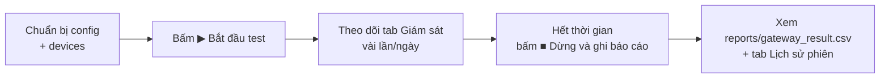

# Hướng dẫn sử dụng — Test Gateway IoT

> Tài liệu thuật toán/thiết kế đọc ở [`README.md`](README.md).
> Muốn hiểu protocol MQTT của firmware, đọc [`docs/MQTT_PROTOCOL_ANALYSIS.md`](docs/MQTT_PROTOCOL_ANALYSIS.md).

**Tool này để làm gì?** Ngồi nghe MQTT từ nhiều gateway IoT (LoRa → Wifi/Ethernet) trong
**nhiều ngày liên tục**, ghi lại mọi bản tin, đối chiếu với **ping** để tách lỗi mạng
khỏi lỗi thiết bị, rồi chốt ra **báo cáo ĐẠT / KHÔNG ĐẠT cho từng gateway**.

Tool **không sửa** firmware và **không sửa** tool nào khác trong repo.

---

## 0. Dùng ngay: chạy file `.exe` (không cần cài gì)

> Đây là cách dùng **chuẩn**. Tool đã được đóng gói sẵn — **không cần** cài Python,
> PyQt5, `pip`, hay bất kỳ môi trường nào khác.

**Cần những gì:**

| Cần | Ghi chú |
|---|---|
| PC **Windows 64-bit** | Windows 10/11 đều được |
| Một chỗ để lưu dữ liệu test | Nên là ổ đĩa còn **vài GB trống** (test 3–4 ngày sinh nhiều CSV) |
| Mạng **LAN/Ethernet** thấy được broker + gateway | Gateway dạng `192.168.10.x`. **Không cần 4G** |

### Bước 1 — Giải nén ra một chỗ cố định

Nếu nhận được file `.zip`, **giải nén trước**. Đặt thư mục ở nơi cố định, ví dụ
`D:\TestGatewayIoT\`.

```
D:\TestGatewayIoT\
├── TestGatewayIoT.exe              ← nháy đúp file này
├── config\                         ← cấu hình (tool tự sinh ở lần chạy đầu)
├── docs\Danh sach 55 gateway.csv   ← danh mục gateway nhà máy
├── HUONG_DAN_SU_DUNG.md            ← tài liệu này
├── README.md                       ← tài liệu kỹ thuật
└── release.json                    ← manifest: phiên bản + SHA-256 từng file
```

> ⚠️ **Đừng** chạy exe trực tiếp bên trong file `.zip`. Tool cần ghi `config\`,
> `data\`, `logs\` **ngay cạnh file exe** — chạy trong `.zip` là mất dữ liệu.

### Bước 2 — Nháy đúp `TestGatewayIoT.exe`

- **GUI mở ra**, kèm một **cửa sổ console đen**. Cửa sổ đó là **cố ý** (dùng để xem
  log và chạy chế độ không GUI) — đừng đóng nó.
- **Lần chạy đầu**, tool tự tạo `config\config.json` + `config\devices.json` cạnh exe
  bằng cách copy bản mẫu đi kèm. Các lần sau nó **không ghi đè** nữa.
- **SmartScreen** có thể hiện *"Windows protected your PC"* ở lần đầu: bản build nội
  bộ **chưa ký số** → bấm **More info → Run anyway**. Antivirus cũng có thể nhận nhầm
  bản onefile của PyInstaller → thêm **ngoại lệ** cho thư mục tool.

### Bước 3 — Khai báo broker & gateway rồi chạy

Xem **mục 3** (tab **⚙ Cấu hình** và **🛰 Thiết bị**). Xong thì bấm **▶ Bắt đầu test**.

### Chạy bằng dòng lệnh

```powershell
.\TestGatewayIoT.exe                              # mở GUI
.\TestGatewayIoT.exe --headless --hours 72        # không GUI, tự dừng sau 72 giờ
.\TestGatewayIoT.exe --version                    # -> test_gateway_iot 1.0.0
.\TestGatewayIoT.exe --help                       # xem mọi tuỳ chọn
```

Bảng tuỳ chọn đầy đủ ở **mục 2.3**.

> ⚠️ **`--hours` chỉ có tác dụng khi đi kèm `--headless`.** Chạy GUI mà truyền `--hours`
> thì tool chỉ ghi cảnh báo vào log rồi bỏ qua.

### Cập nhật bản mới / gỡ tool

Chỉ cần **thay file `TestGatewayIoT.exe`**. Giữ nguyên thư mục `config\` và `data\` là
**giữ nguyên cấu hình và toàn bộ phiên test cũ**. Mỗi phiên nằm riêng trong
`data\runs\<mã phiên>\` nên **không bao giờ ghi đè nhau**. Muốn gỡ sạch thì xoá cả
thư mục tool.

### ⚠️ Không dùng 4G

Tool chỉ cần **TCP/IP thường**: MQTT tới broker + ICMP ping tới gateway. Bản exe
**không chứa** thư viện modem/cellular nào, nên **không thể** và **không cần** dùng 4G.
PC chỉ cần thấy được broker và các gateway qua **LAN/Ethernet**. Bật/tắt Wi-Fi hay rút
cáp 4G **không ảnh hưởng** tới tool miễn là còn đường tới broker.

### Không có file `.exe`?

Nếu bạn chỉ có **mã nguồn**: đọc **mục 1** (cài môi trường) và **mục 2** (cách chạy).
Muốn tự build lại exe để gửi cho người khác → **mục 11**.

---

## 1. Cài môi trường (chỉ khi chạy từ **mã nguồn**)

> Chỉ cần mục này nếu bạn **không** dùng file `.exe`. Người dùng exe bỏ qua mục 1 và 2,
> đọc **mục 0** là đủ.

### 1.1. Yêu cầu

| Thành phần | Ghi chú |
|---|---|
| **Python 3.10+** (repo đang dùng 3.14) | Cần có `python` trong PATH |
| **Windows / Linux / macOS** | Chạy mã nguồn thì tool chạy tốt trên cả ba. Bản `.exe` chỉ có cho **Windows 64-bit** |
| **Kết nối tới broker MQTT** | Broker thật, thường là LAN hoặc Internet |
| **PyQt5** | Chỉ cần nếu mở **GUI**. Chạy `--headless` thì không cần |

> Dùng file `.exe` thì **không cần** Python, PyQt5 hay pip — xem mục 0.

### 1.2. Cài thư viện

Mở PowerShell tại thư mục tool rồi chạy:

```powershell
pip install -r requirements.txt
```

`requirements.txt` gồm: `paho-mqtt`, `requests`, `pyserial`, `PyQt5`.

### 1.3. Bật UTF-8 cho console (Windows — **rất quan trọng**)

Console Windows mặc định là `cp1252`, sẽ văng `UnicodeEncodeError` khi in tiếng Việt.
**Luôn đặt biến môi trường này trước khi chạy:**

```powershell
$env:PYTHONUTF8 = "1"
```

> Nếu dùng `run.ps1` thì không cần quan tâm — script đã in ASCII thuần để tránh lỗi này.
> Bản `.exe` cũng **tự bật UTF-8** khi khởi động, nên chạy exe không cần đặt gì.

---

## 2. Cách chạy (từ **mã nguồn**)

> Dùng file `.exe` thì **không cần** phần này — xem **mục 0**.

### 2.1. Chạy GUI (dễ dùng, xem trực tiếp)

```powershell
$env:PYTHONUTF8 = "1"
python main.py
```

hoặc dùng script tiện lợi (tự `pip install` rồi mở):

```powershell
.\run.ps1
```

### 2.2. Chạy KHÔNG GUI (khuyến nghị cho test 3–4 ngày)

Ít rủi ro hơn: máy không cần màn hình, không sợ GUI treo, dữ liệu vẫn ghi đầy đủ.

```powershell
$env:PYTHONUTF8 = "1"
python main.py --headless
python main.py --headless --hours 72          # tự dừng sau 72 giờ
```

hoặc:

```powershell
.\run.ps1 -Headless -Hours 72
```

**Dừng bằng `Ctrl+C`:** tool sẽ xử lý nốt hàng đợi → ghi báo cáo → cập nhật
`meta.json`. Không tắt bằng cách đóng cửa sổ.

### 2.3. Các tuỳ chọn dòng lệnh

| Tuỳ chọn | `.exe` | Mã nguồn | Ý nghĩa |
|---|---|---|---|
| `--headless` | ✅ | ✅ | Không mở GUI (vẫn nhận MQTT, ghi CSV, ping, chốt báo cáo) |
| `--hours N` | ✅ | ✅ | Tự dừng sau N giờ (**chỉ dùng kèm `--headless`**) |
| `--config-dir PATH` | ✅ | ✅ | Dùng thư mục cấu hình khác (mặc định `config/` cạnh exe) |
| `--log-level` | ✅ | ✅ | `DEBUG` / `INFO` / `WARNING` / `ERROR` (mặc định `INFO`) |
| `--version` | ✅ | ✅ | In phiên bản tool |
| `--help` | ✅ | ✅ | Xem trợ giúp |

Đúng một dòng lệnh cho mỗi cách chạy:

```powershell
# Bản .exe
.\TestGatewayIoT.exe --headless --hours 72 --log-level DEBUG

# Từ mã nguồn
$env:PYTHONUTF8 = "1"
python main.py --headless --hours 72 --log-level DEBUG
```

### 2.4. Tham số của `run.ps1`

| Tham số | Ý nghĩa |
|---|---|
| `-Headless` | Chạy không GUI |
| `-Hours N` | Dừng sau N giờ |
| `-Python PATH` | Chỉ định Python khác |
| `-LogLevel` | Mức log |
| `-Install` / `-NoInstall` | Bắt buộc / bỏ qua `pip install` |
| `-Test` | Chạy smoke test + GUI smoke test rồi thoát |

---

## 3. Chuẩn bị trước khi test (làm 1 lần, ~5 phút)

### 3.1. Khai báo broker — tab **⚙ Cấu hình**

Mở GUI → tab **⚙ Cấu hình**, điền:

| Trường | Ví dụ / mặc định |
|---|---|
| **Host *** | `45.117.170.179` |
| **Port *** | `1885` (kiểm tra lại với người quản lý broker — repo này dùng 1885) |
| **Username / Password** | Để trống nếu broker không yêu cầu |
| **Client ID** | Để trống = tự sinh |
| **Topic chính *** | `node/#` |
| **Topic bổ sung** | (tuỳ chọn) |
| **Topic log** | `+/+/log` — chỉ dùng khi tick ô bật log gateway |

Bấm **🔌 Kiểm tra kết nối broker** để chắc chắn thông. Sau đó bấm **💾 Lưu cấu hình**.

> ⚠️ Sửa cấu hình **không** áp vào phiên đang chạy. Cứ lưu trước khi bấm Bắt đầu.

### 3.2. Khai báo danh sách gateway — tab **🛰 Thiết bị**

Mỗi gateway cần: **UID** (11–12 hex), **Tên** (dễ đọc), **IP mạng LAN** (để ping),
và 2 ô tick **đưa vào phiên test** / **bật ping**.

- **➕ Thêm gateway** — thêm dòng mới
- **✎ Sửa** — sửa UID / tên / IP
- **🗑 Xoá** — bỏ khỏi danh sách theo dõi
- **⏻ Bật/Tắt** — tạm loại gateway khỏi phiên mà không xoá

Danh sách cũng lưu ở `config/devices.json`, sửa tay được:

```json
[
  { "uid": "E006199E139C", "name": "MGWI-V1-26070012", "eth_ip": "192.168.10.101",
    "enabled": true, "ping_enabled": true, "notes": "" }
]
```

> **Lưu ý:** UID có thể là **11 hoặc 12 hex** (firmware không zero-pad). Tool tự chuẩn
> hoá nên hai dạng luôn nhận ra cùng một gateway — bạn nhập kiểu nào cũng được.

---

## 4. Quy trình test dài ngày (3–4 ngày)



1. **Cấu hình** broker + gateway (§3).
2. (Khuyến nghị) Bật **Node trọng tâm** để đo **bắt hụt** (gateway khác nghe được
   mà gateway này không publish) và **bắn hụt** (publish trễ). Cách nhanh nhất: ở
   bảng **Tổng hợp node**, **nháy đúp** vào node muốn theo dõi. Xem §5.6.
3. (Không bắt buộc) Gõ **Tên phiên** ở toolbar, ví dụ *"test lại GW 4F9199"*.
4. Bấm **▶ Bắt đầu test**.
5. Kiểm tra sức khoẻ định kỳ ở tab **📡 Giám sát** (§5.1). Nếu chạy headless thì xem
   log ở `logs/test_gateway_iot.log` tiến độ in 10 phút/lần.
6. Khi đủ thời gian → bấm **■ Dừng & ghi báo cáo** (hoặc `Ctrl+C` nếu headless).
7. Xem kết quả ở tab **📜 Lịch sử phiên** (§5.4), đặc biệt cột **KẾT QUẢ**.

> **Nút "📊 Ghi báo cáo ngay"** chốt báo cáo vào thư mục phiên mà **không dừng** test —
> hữu ích để lấy kết quả tạm giữa chừng.

---

## 5. Hướng dẫn từng tab GUI

GUI có 5 tab, xếp theo tần suất dùng: **📡 Giám sát → 🛰 Thiết bị → 🔍 Tìm kiếm → 📜 Lịch sử phiên → ⚙ Cấu hình**.

### 5.1. 📡 Giám sát — trái tim của tool

Toolbar trên cùng:

| Nút | Việc nó làm |
|---|---|
| **▶ Bắt đầu test** | Mở phiên mới, bắt đầu nghe MQTT + ping |
| **⏸ Tạm dừng** | Nghỉ giữa chừng: **ngừng ghi bản tin, ngừng chạy ICMP, đồng hồ đứng**. Vẫn giữ kết nối broker để tiếp tục tức thì |
| **■ Dừng & ghi báo cáo** | Kết thúc phiên, chốt toàn bộ báo cáo |
| **📊 Ghi báo cáo ngay** | Chốt báo cáo tạm mà không dừng |
| **📂 Mở thư mục log** | Mở thư mục dữ liệu phiên hiện tại |
| **Tên phiên** | Đặt tên trước khi chạy (không bắt buộc) |

> **Nút "⏸ Tạm dừng" là thật, không phải chỉ đổi nhãn.** Khi tạm dừng:
>
> - Tool **không ping** nữa — bộ đếm ping (thành công / thất bại / ping/s) **đứng yên**,
>   không sinh bản ghi ping nào. Nhờ vậy khoảng nghỉ **không** bị ghi thành downtime giả.
> - **Đồng hồ đứng**: thẻ *Thời gian chạy* hiện `⏸ (đang tạm dừng, đã nghỉ ...)`, và
>   thời gian nghỉ **không** được tính vào `duration_seconds` của phiên.
> - Bộ phát hiện im lặng được **dịch mốc** khi tiếp tục, nên không có loạt cảnh báo
>   `NODE_SILENT` / `GATEWAY_SILENT` giả cho quãng tool cố ý không nhận gì.
> - Bấm **▶ Tiếp tục** để chạy lại; mọi thứ tiếp tục từ chỗ dừng, có ghi log rõ
>   đã nghỉ bao nhiêu phút.

**8 thẻ chỉ số** (cập nhật mỗi 500 ms):

| Thẻ | Cho biết |
|---|---|
| **Trạng thái** | IDLE / RUNNING / PAUSED / STOPPED / ERROR |
| **Thời gian chạy** | Đã chạy bao lâu (**đã trừ thời gian tạm dừng**) + giờ bắt đầu. Khi tạm dừng hiện `⏸ tạm dừng — đã nghỉ ...` |
| **Kết nối MQTT** | Đã kết nối chưa, số lần reconnect, uptime |
| **Bản tin nhận được** | Tổng số + tách theo DATA / INFO / ERROR / LOG |
| **Node/Gateway** | Số node phát hiện được + số gateway cấu hình |
| **Chất lượng dữ liệu** | % thiếu SEQ + số thiếu / trùng / sai thứ tự |
| **Ping gateway** | % ping OK + số thành công/tổng + **tổng thời gian downtime và số lần mất kết nối** |
| **Ghi xuống đĩa** | Số dòng đã ghi + số dòng bỏ/lỗi ghi |

**5 bảng con** (chọn ở các tab ngay dưới thẻ chỉ số):

- **Bản tin trực tiếp** — các bản tin vừa nhận (bị giới hạn số dòng cho nhẹ GUI;
  dữ liệu đầy đủ luôn nằm trong CSV).
- **Tổng hợp node** — 1 dòng / node: số gói, SEQ đầu/cuối, thiếu/trùng/sai thứ tự,
  tỉ lệ nhận. **Nháy đúp một dòng để theo dõi node đó** ở trang *Node trọng tâm*
  (xem §5.6).
- **Cảnh báo** — node im lặng, gateway im lặng, tỉ lệ thiếu cao…
- **Downtime** — **chi tiết từng khoảng gateway mất kết nối ping** (xem §6.2).
- **Node trọng tâm** — bắt hụt / bắn hụt của node đang theo dõi (§5.6).

Dưới cùng là khung **nhật ký (log)** của chính tool.

### 5.2. 🛰 Thiết bị

Quản lý danh sách gateway (thêm/sửa/xoá/bật-tắt). Cột **Tỉ lệ ping (%)** hiển thị
tỉ lệ ping đã đo của từng gateway (tra theo UID, chịu được khác biệt 11/12 hex).
Danh sách này lưu vào `config/devices.json`.

### 5.3. 🔍 Tìm kiếm — tra cứu bản tin thô trong CSV

Dùng để tìm chính xác một bản tin trong hàng trăm nghìn dòng mà không cần mở Excel.

**Bộ lọc:**

| Trường | Ví dụ |
|---|---|
| **Phạm vi** | Toàn bộ `data/runs/…`, hoặc chọn 1 phiên cụ thể |
| **Gateway UID** | `4F9199E139C` (khớp một phần cũng được) |
| **Receiver UID** | `64B5B30615E18000` (16 hex) |
| **Node UID** | 16 hoặc 24 hex |
| **SEQ** | `123` hoặc khoảng `100-200` |
| **Loại bản tin** | (tất cả) / DATA / DATA_NO_SEQ / INFO / ERROR / LOG / UNKNOWN |
| **Bất thường** | trùng, sai thứ tự, reset SEQ, giá trị cảm biến lạ… |
| **Lỗi chứa** | `CRC ERROR`, `LENGTH`… |
| **Từ khoá** | Bất kỳ chuỗi nào trong payload / topic |
| **từ … đến** | Khoảng thời gian |
| **Số dòng / trang** | Phân trang cho nhẹ RAM |

**Nút:** **🔍 Tìm kiếm** · **◀ Trang trước** · **Trang sau ▶** ·
**💾 Xuất kết quả ra CSV** · **📂 Mở thư mục dữ liệu**

### 5.4. 📜 Lịch sử phiên — xem lại mọi phiên đã chạy

Liệt kê **tất cả** phiên trong `data/runs/` (mới nhất trước), kể cả phiên bị **tắt
ngang** (mất điện / kill / đóng console).

**Cột danh sách phiên:** tên, mã phiên, bắt đầu, trạng thái, thời lượng, số gateway
đã cấu hình, số gateway nghe được, tổng bản tin, số node, gói thiếu, ping fail,
số báo cáo, dung lượng.

> **Cột "thời lượng" là thời gian ĐO ĐƯỢC, đã trừ mọi quãng tạm dừng.** Trang
> **Tổng kết** trong tab này tách rõ hai con số: *Thời lượng đo được (giây)*
> (`duration_seconds`) và *Thời gian tạm dừng (giây)* (`paused_seconds`). Nhờ vậy
> các phiên có tạm dừng vẫn so sánh được với nhau — tỉ lệ phần trăm không còn bị
> pha loãng bởi thời gian tool cố ý không đo.

**Nút:**

| Nút | Việc nó làm |
|---|---|
| **🔄 Làm mới danh sách** | Quét lại `data/runs/` |
| **Lọc** (combo) | Lọc theo trạng thái / kết quả |
| **⚖ Chấm lại kết quả** | Tính lại ĐẠT/KHÔNG ĐẠT cho phiên cũ từ dữ liệu thô |
| **Gateway** (ô tìm) | Tìm phiên theo UID hoặc tên gateway |
| **✖ Xoá tìm kiếm** | Bỏ từ khoá, hiện lại mọi phiên |
| **✏ Đặt / đổi tên phiên** | Ghi tên dễ đọc vào `meta.json` |
| **🏷 Bổ sung tên gateway theo UID** | Điền tên gateway vào các phiên cũ thiếu tên |
| **📂 Mở thư mục phiên** | Mở `data/runs/<phiên>/` |
| **📊 Mở thư mục báo cáo** | Mở `reports/` của phiên |
| **🔍 Xem bản tin thô trong Tìm kiếm** | Nhảy sang tab Tìm kiếm, khoanh sẵn đúng phiên đó |
| **🗑 Xoá phiên này** | Xoá thư mục phiên (cẩn thận!) |

**Các trang báo cáo** (mỗi trang đọc 1 file CSV): **Tổng kết**, **Kết quả**,
**Node**, **Ping**, **MQTT ↔ Ping**, **Node trọng tâm**, **Bắt hụt theo SEQ**,
**Bắn hụt (trễ)**, **Downtime**, **MQTT im lặng**, **Cảnh báo**.

> Phiên cũ (chạy bằng bản tool chưa có `analytics/gateway_result.py`) không có trang
> **Kết quả** → bấm **⚖ Chấm lại kết quả** để dựng lại. Nút này **chỉ đọc** dữ liệu
> thô rồi **ghi thêm** báo cáo, tuyệt đối **không sửa** dữ liệu gốc.

### 5.5. ⚙ Cấu hình

Sửa mọi tham số: broker, TLS/reconnect, topic, SEQ, cảnh báo, ping, tương quan,
node trọng tâm, storage, giao diện, logging. Bấm **🔌 Kiểm tra kết nối broker** để
thử, **💾 Lưu cấu hình** để ghi vào `config/config.json`.

Form bị **khoá trong lúc phiên đang chạy** (đổi ngưỡng giữa phiên sẽ làm sai thống kê).

### 5.6. Node trọng tâm — đo "bắt hụt" và "bắn hụt"

**Cách nhanh nhất — nháy đúp:**

1. Ở tab **📡 Giám sát** → bảng con **Tổng hợp node**.
2. **Nháy đúp** vào dòng của node muốn soi. Tool **bật theo dõi luôn** node đó và
   **tự chuyển** sang trang **Node trọng tâm** — không cần copy UID thủ công.
3. Xem xong, bấm **◀ Thoát ra (Tổng hợp node)** để quay lại bảng node và chọn node
   khác. **Thoát ra KHÔNG bỏ theo dõi**: số liệu bắt hụt / bắn hụt vẫn tiếp tục
   được thu cho node đang chọn, và ô *UID node theo dõi* giữ nguyên UID.

**Cách nhập tay:** ở trang *Node trọng tâm*, gõ UID vào ô **UID node theo dõi** rồi
bấm **Theo dõi** (hoặc Enter). Bấm **Bỏ theo dõi** để ngừng hẳn.

Tool so bản tin của node đó trên **mọi gateway**:

- **BẮT HỤT** — node đã phát (gateway khác nghe được) mà gateway này **không publish**.
- **BẮN HỤT** — gateway **có** publish nhưng **trễ** (`received_at − gateway_timestamp`
  vượt `focused_node_late_seconds`, mặc định 30 s; dấu hiệu buffer SD / backfill).

Đây là bằng chứng **trực tiếp** phân biệt "gateway yếu" với "node không phát" — quan
trọng khi kết luận. Kết quả ghi vào `reports/focused_node_*.csv`.

> **Đổi node giữa phiên sẽ XOÁ số liệu của node cũ** (không trộn hai node vào một
> bảng). Nếu muốn giữ số liệu node đang xem, đừng nháy đúp sang node khác.

---

## 6. Đọc kết quả

### 6.1. Báo cáo ở đâu?

Mỗi phiên tạo một thư mục `data/runs/<YYMMDD_HHMMSS>_<suffix>/`:

```
data/runs/<run_id>/
├── meta.json                 # thông tin phiên (run_id, broker, gateway, tên, ngưỡng…)
├── mqtt/                     # dữ liệu thô
│   ├── mqtt_data_*.csv           # MỌI bản tin tool nhận được (36 cột)
│   ├── mqtt_missing_*.csv        # các khoảng SEQ bị thiếu
│   ├── mqtt_anomalies_*.csv      # bất thường (trùng, sai thứ tự, reset…)
│   ├── mqtt_errors_*.csv         # khung node/error đã gộp
│   ├── gateway_log_*.csv         # report hệ thống + Last Will (nếu bật)
│   └── alerts_*.csv              # cảnh báo do tool sinh
├── ping/                     # dữ liệu ping
│   ├── ping_*.csv                # từng lần ping (RTT, thành công/thất bại)
│   └── downtime_*.csv            # ⬅ sự kiện gateway mất/hồi phục (§6.2)
└── reports/                  # báo cáo tổng hợp
    ├── node_summary.csv
    ├── ping_summary.csv
    ├── correlation_summary.csv
    ├── mqtt_silence.csv
    ├── alerts_summary.csv
    ├── run_summary.csv           # 1 dòng chốt cả phiên (kèm KẾT QUẢ)
    ├── gateway_result.csv        # ⬅ ĐẠT / KHÔNG ĐẠT từng gateway (§6.3)
    ├── gateway_downtime.csv      # ⬅ chi tiết downtime (§6.2)
    └── focused_node_*.csv        # bắt hụt / bắn hụt
```

Tool **không** có database — **CSV là nguồn chân lý**. Đóng cửa sổ GUI không mất dữ liệu.

### 6.2. ⏱ Downtime — thời gian ngắt kết nối ping

**Downtime** = khoảng thời gian gateway **không trả lời ping** (ICMP). Đây là dữ liệu
**chẩn đoán**, giúp bạn biết gateway mất mạng bao lâu — **nó vẫn luôn được hiển thị và
xuất ra**, chỉ **không** dùng để chấm ĐẠT/KHÔNG ĐẠT (xem §6.3 để hiểu vì sao).

**Downtime hiển thị ở 4 nơi:**

| Nơi | Nội dung |
|---|---|
| Tab **📡 Giám sát** → thẻ **Ping gateway** | Tổng thời gian downtime của cả phiên + số lần mất kết nối, ví dụ `downtime 00:04:12 (2 lần)` |
| Tab **📡 Giám sát** → bảng **Downtime** | Từng khoảng: **Bắt đầu mất**, **Hồi phục**, Gateway, IP, **Thời lượng (s)**, **Số ping fail**, **Trạng thái** (🔴 `ONGOING` = đang mất / 🟢 `CLOSED` = đã hồi phục) |
| Tab **📜 Lịch sử phiên** → trang **Downtime** | Đọc `reports/gateway_downtime.csv`: Gateway, Tên, IP, **Bắt đầu mất**, **Hồi phục**, **Thời lượng (s)**, **Số ping fail**, **Trạng thái**, **Đã hồi phục**, **Ping fail cuối** |
| Tab **📜 Lịch sử phiên** → trang **Ping** | Đọc `reports/ping_summary.csv`: cột **Số lần downtime**, **Downtime (s)** theo từng gateway |

**Báo cáo ghi ra:**

- `ping/downtime_*.csv` — từng sự kiện mất/hồi phục.
- `reports/gateway_downtime.csv` — bảng chi tiết theo gateway.
- `reports/ping_summary.csv` — cột `downtime_events`, `downtime_seconds` theo gateway.
- `reports/run_summary.csv` — cột `downtime_events`, `downtime_seconds` cho cả phiên.
  Cột `duration_seconds` là **thời gian đo thực tế**; cột `paused_seconds` ghi riêng
  tổng thời gian đã tạm dừng. Cộng hai cột này mới ra độ dài theo giờ tường.
- `reports/gateway_result.csv` — cột `downtime_events`, `downtime_seconds` (**tham khảo**).

**Cách hoạt động:** cứ mỗi `ping_interval_seconds` (mặc định 10 s) tool ping song
song từng gateway. Ping fail **liên tiếp** `ping_down_threshold` lần (mặc định 2) mới
coi là **DOWN** → mở một cửa sổ downtime. Ping thành công trở lại → **đóng** cửa sổ và
ghi lại `duration_seconds`. Nếu tool dừng khi cửa sổ còn mở, nó ghi trạng thái `ONGOING`.

> **Lúc TẠM DỪNG tool không ping**, nên khoảng nghỉ không bao giờ bị tính thành downtime.
> Khi **Tiếp tục**, chuỗi ping fail trước đó được xoá (không cộng dồn qua quãng nghỉ) —
> nếu không, hai lần fail trước khi nghỉ + một lần fail sau khi chạy lại sẽ bị ghép
> thành một cửa sổ mất kết nối mà thực tế không hề có.

> **Quan trọng:** downtime là **tổng thời gian ping fail**, không phải "gateway hỏng".
> Một gateway có MQTT **hoàn toàn khoẻ** vẫn tích luỹ downtime nếu **ICMP bị tường lửa
> / ISP chặn** hoặc mạng chập chờn. Vì vậy đừng đọc downtime như kết luận hỏng máy —
> hãy đối chiếu thêm `coverage_percent` và cột `verdict` (§6.3).

### 6.3. Kết quả ĐẠT / KHÔNG ĐẠT — `reports/gateway_result.csv`

Mở nhanh: **`reports/run_summary.csv`** có 4 cột chốt `gateways_passed`,
`gateways_failed`, `result`, `result_reason` — 1 dòng là biết cả phiên đạt hay không.

`gateway_result.csv` có **1 dòng mỗi gateway** + **1 dòng TỔNG** ở cuối
(`gateway_uid = TỔNG`). Mỗi tiêu chí là 1 cột nhận `PASS` / `FAIL` / `N/A`.

**4 tiêu chí** (đều là bằng chứng **trực tiếp**):

| # | Cột | Tên | Đạt khi | Nguồn |
|---|---|---|---|---|
| 1 | `c_valid` | Có dữ liệu | gateway publish ≥ 1 bản tin | `mqtt_data_*.csv` |
| 2 | `c_coverage` | Độ phủ bản tin | hụt ≤ `100 − criteria_min_coverage_percent` (%) | số bản tin publish / kỳ vọng |
| 3 | `c_ping` | Tỉ lệ ping | ping OK ≥ `criteria_min_ping_ok_percent` (%) | `ping_summary.csv` |
| 4 | `c_late` | Bắn hụt (gửi trễ) | % publish trễ ≤ `criteria_max_late_percent` | `focused_node_summary.csv` |

**3 mức, không phải 2:** `N/A` = **chưa đủ dữ liệu để chấm** (chưa ping lần nào,
chưa bật node trọng tâm, dưới `min_packets_for_rate`) — **khác hẳn** `FAIL`.

**Một gateway ĐẠT chỉ khi không tiêu chí nào `FAIL`** (`N/A` không cản). Ngược lại là
`KHÔNG ĐẠT`, và cột `result_reason` ghi rõ **tiêu chí nào hỏng kèm số so với ngưỡng**,
ví dụ:

```
Độ phủ bản tin: hụt 23.50% (cho phép ≤ 20.00%);
Tỉ lệ ping: ping OK 89.32% (cần ≥ 90.00%)
```

> **Downtime KHÔNG nằm trong 4 tiêu chí trên.** Cùng bị loại khỏi kết luận còn có
> `c_link` (Kết nối MQTT) và `c_stable` (Ổn định MQTT) — vì cả ba đều là **suy luận
> gián tiếp**, có thể khiến gateway khoẻ bị "trượt oan".
>
> **NHƯNG các cột này VẪN đầy đủ trong CSV và vẫn hiển thị trên GUI:**
> `downtime_events`, `downtime_seconds` (trang Ping & Downtime), `verdict`,
> `windows_total`, `silence_windows`, `silence_percent` (trang MQTT ↔ Ping).
> Chúng dùng để **chẩn đoán**, không dùng để chấm điểm.
>
> Cột `verdict` (tham khảo, **không** chấm điểm): `OK` (bình thường),
> `PING_BLOCKED` (ping bị chặn nhưng MQTT vẫn chạy — **không phải lỗi gateway**),
> `LINK_DOWN` / `GATEWAY_SILENT` (nghi vấn thật), `PARTIAL` (trộn nhiều kiểu),
> `NO_DATA` (không đủ dữ liệu).

### 6.4. Cấu hình ngưỡng chấm điểm

| Khoá (`config.json`) | Mặc định | Nghĩa |
|---|---|---|
| `criteria_min_coverage_percent` | `80.0` | Cho phép hụt tối đa `100 − giá trị này` (%) |
| `criteria_min_ping_ok_percent` | `90.0` | Ping OK tối thiểu (%) |
| `criteria_max_late_percent` | `5.0` | % publish trễ tối đa (khi có node trọng tâm) |
| `min_packets_for_rate` | `50` | Cỡ mẫu tối thiểu; dưới ngưỡng → `N/A` |

Mỗi phiên lưu **ảnh chụp ngưỡng** vào `meta.json` (`scoring_params`) lúc bắt đầu, nên
"Chấm lại kết quả" luôn cho **cùng kết quả** với lúc chốt — không phụ thuộc config hiện tại.

---

## 7. Kiểm tra trước khi mang đi test thật

> Phần này dành cho người **chạy từ mã nguồn** (cần Python). Người dùng bản `.exe`
> không cần chạy test — chỉ cần mở tool lên, kiểm tra broker thấy **xanh** ở tab
> **⚙ Cấu hình**, và thấy ping > 0 % ở tab **🛰 Thiết bị**.

Không cần mạng, không cần broker, tự dọn thư mục tạm:

```powershell
$env:PYTHONUTF8 = "1"

python tests/smoke_test.py        # logic: config, parse, SEQ, CSV, báo cáo, session
python -m pytest tests/ -q        # unit test (focused node, gateway result, rescore)
python tests/gui_smoke_test.py    # dựng GUI rồi đóng (offscreen)
python -m compileall -q .         # kiểm tra cú pháp toàn bộ file
```

Hoặc 1 lệnh: `.\run.ps1 -Test`

Tất cả trả **exit code 0** khi đạt. `gui_smoke_test.py` sẽ **SKIP** (vẫn exit 0) nếu
máy không có PyQt5.

---

## 8. Lỗi thường gặp & cách xử lý

### 8.1. Chỉ gặp khi dùng bản `.exe`

| Hiện tượng | Nguyên nhân / Cách xử lý |
|---|---|
| Windows hiện *“Windows protected your PC”* | Bản build nội bộ **chưa ký số**. Bấm **More info → Run anyway** |
| Antivirus xoá / chặn `TestGatewayIoT.exe` | Bản onefile của PyInstaller hay bị nhận nhầm. Thêm **ngoại lệ** cho thư mục tool trong antivirus |
| Nháy đúp mà **không có gì xảy ra** | Kiểm tra còn **cửa sổ console đen** đang mở không (lỗi được in ở đó). Thử chạy bằng PowerShell để đọc lỗi trực tiếp |
| Mở tool từ **trong file `.zip`** | Tool không ghi được `config/`/`data/`/`logs/`. **Giải nén ra thư mục thật** trước khi chạy |
| Không tạo được `config/` cạnh exe | Thư mục đặt ở nơi **chỉ đọc** (vd `C:\Program Files\) hoặc ổ mạng. Chuyển sang `D:\TestGatewayIoT\` |
| Mất cấu hình / mất phiên cũ sau khi cập nhật | Đã **chuyển sang chỗ khác** thay vì chỉ thay file exe. `config/` + `data/` phải nằm **cùng** thư mục với exe |
| Cửa sổ **console đen** hiện cùng GUI | **Cố ý** — đó là nơi in log và là chế độ `--headless`. Đừng đóng |
| Chữ trong cửa sổ console bị **méo dấu** | Chỉ là cách PowerShell 5.1 hiển thị UTF-8. **File log trên đĩa vẫn đúng.** Chỉ cần nhìn GUI |
| `--hours 72` không tự dừng | `--hours` **chỉ** tác dụng khi đi kèm `--headless` |
| Không thấy bảng **Kết quả** ở tab Lịch sử phiên | Phiên chạy bằng bản tool cũ chưa có `gateway_result.csv` → bấm **⚖ Chấm lại kết quả** |

### 8.2. Gặp ở cả hai cách chạy

| Hiện tượng | Nguyên nhân / Cách xử lý |
|---|---|
| `UnicodeEncodeError` khi chạy script | Console Windows là `cp1252` → chạy `$env:PYTHONUTF8 = "1"` trước. (Bản `.exe` tự bật UTF-8, không cần) |
| `ModuleNotFoundError: paho` / `requests` / `PyQt5` | Chỉ xảy ra khi chạy **mã nguồn**: chưa `pip install -r requirements.txt` (chạy `--headless` thì không cần PyQt5) |
| Thẻ **Kết nối MQTT** đỏ liên tục | Sai Host/Port/username/password, hoặc broker chặn. Bấm **🔌 Kiểm tra kết nối broker** ở tab Cấu hình |
| Không thấy bản tin nào | Sai **topic chính** (mặc định `node/#`), hoặc chưa Bắt đầu test |
| **Bản tin từ gateway lạ** tăng | UID không có trong `config/devices.json` → thêm vào tab Thiết bị. Dữ liệu vẫn được ghi đầy đủ |
| Ping OK 0 % nhưng MQTT vẫn chạy | ICMP bị tường lửa/ISP chặn. Đọc cột `verdict` — `PING_BLOCKED` **không phải** lỗi gateway |
| Downtime cao nhưng gateway gửi đều | Bình thường nếu ping bị chặn/chập chờn — downtime **không** phải kết luận hỏng (xem §6.2) |
| Bảng **Bản tin trực tiếp** chỉ hiện vài nghìn dòng | Cố ý giới hạn cho nhẹ GUI. Dữ liệu đầy đủ trong `mqtt/mqtt_data_*.csv` |
| Tab Giám sát không cập nhật | Bấm **🔄** / chuyển tab / kiểm tra thẻ **Trạng thái**. GUI lag **không** làm mất dữ liệu |
| Cảnh báo `QFontDatabase: Cannot find font directory` (offscreen) | Vô hại |
| `OverflowError` khi mở cửa sổ | Có `QSpinBox` bị đặt trần > int32 (2 147 483 647). Hạ giá trị trong config |
| Phiên còn `status = RUNNING` dù đã tắt | Phiên bị tắt ngang (mất điện/kill). Dữ liệu tới lúc tắt vẫn còn; bấm **⚖ Chấm lại kết quả** để có báo cáo |
| Muốn xoá phiên test | Tab Lịch sử phiên → **🗑 Xoá phiên này** (không thể hoàn tác) |

---

## 9. Vài lưu ý cho người mới

- **Thẻ "Ping gateway" ở tab Giám sát có 2 vai trò:** vừa cho biết ping OK bao nhiêu %,
  vừa cho biết **tổng thời gian downtime và số lần mất kết nối** — xem ngay con số
  đó khi cần biết gateway mất mạng bao lâu.
- **Downtime là để xem, không phải để phán.** Muốn kết luận gateway đạt hay không, hãy
  xem `reports/gateway_result.csv` (hoặc trang **Kết quả** ở tab Lịch sử phiên).
- **Muốn chắc chắn một gateway "yếu" là do nó hay do node:** bật **Node trọng tâm**
  (§5.6) để đo **bắt hụt** — gateway khác nghe được mà nó không publish.
- **Không sửa cấu hình giữa phiên** — ngưỡng sẽ không khớp thống kê.
- **Không commit thư mục `data/`** — nặng hàng GB và đã nằm trong `.gitignore`.

---

## 10. Tham khảo thêm

- [`README.md`](README.md) — tài liệu kỹ thuật đầy đủ (thuật toán, ràng buộc thiết kế,
  giới hạn đã biết, ý nghĩa mọi chỉ số, lịch sử phiên).
- [`docs/MQTT_PROTOCOL_ANALYSIS.md`](docs/MQTT_PROTOCOL_ANALYSIS.md) — phân tích protocol
  MQTT đọc trực tiếp từ firmware.
- `docs/Danh sach 55 gateway.csv` — danh sách gateway tham chiếu.

---

## 11. Đóng gói bản phát hành (`.exe` + JSON)

Dành cho người **phát triển** muốn tạo file `.exe` để gửi cho đồng nghiệp hoặc up lên git.

> **Bạn sửa code xong và muốn ra `.exe` mới?** Làm theo **§11.0** bên dưới —
> chỉ 5 bước, copy/paste được. §11.1 trở đi là giải thích chi tiết từng phần.

### 11.0. Quy trình build lại `.exe` mỗi khi sửa code (5 bước)

**Bước 0 — Đóng tool đang chạy.** Nếu `TestGatewayIoT.exe` (hoặc GUI từ mã nguồn) đang
mở thì **phải tắt trước**, nếu không Windows khoá file và bước copy sẽ báo
`The process cannot access the file`.

Mở **PowerShell** và vào thư mục repo:

```powershell
cd C:\MKAC\Test_many_gateway
```

**Bước 1 — Chạy bản mã nguồn để thử ngay (nhanh nhất, không cần build).**
Sửa code xong thì thử ở đây trước — build exe mất ~1 phút nên đừng build vội:

```powershell
$env:PYTHONUTF8 = "1"
c:\python314\python.exe main.py
```

*(Nếu `python` đã có trên PATH thì dùng `python main.py`. Biến `PYTHONUTF8` là bắt buộc,
thiếu nó log tiếng Việt sẽ ném `UnicodeEncodeError`.)*

**Bước 2 — Chạy test.** Đừng build khi test còn đỏ:

```powershell
$env:PYTHONUTF8 = "1"
c:\python314\python.exe -m pytest tests/ -q
c:\python314\python.exe tests\smoke_test.py
$env:QT_QPA_PLATFORM = "offscreen"
c:\python314\python.exe tests\gui_smoke_test.py
Remove-Item Env:QT_QPA_PLATFORM
```

Cả ba phải xanh: `pytest` báo số test **passed**, hai smoke test in
`KẾT QUẢ: TẤT CẢ ... KIỂM TRA ĐẠT`.

**Bước 3 — Build lại exe + gói phát hành (một lệnh duy nhất):**

```powershell
powershell -NoProfile -ExecutionPolicy Bypass -File .\tools\build_release.ps1 -Python c:\python314\python.exe
```

Script tự làm hết: đọc phiên bản từ `core/__init__.py` → PyInstaller build → copy
`config/`, `docs/`, `HUONG_DAN_SU_DUNG.md`, `README.md` vào `release\1.0.0\` →
sinh `release.json` → nén `.zip`.

> **Lưu ý quan trọng:** PyInstaller **trả mã thoát 1 kể cả khi build thành công**.
> Đừng nhìn exit code — hãy tìm dòng **`Build complete!`** trong log. Build xong sẽ
> thấy `Build complete!` rồi danh sách file kèm SHA-256.

**Bước 4 — Kiểm tra gói vừa sinh (tuỳ chọn nhưng nên làm).** Đoạn lệnh dưới đối chiếu
lại toàn bộ SHA-256 trong manifest, in ra `bad=0` nghĩa là gói nguyên vẹn:

```powershell
cd release\1.0.0
$m = Get-Content .\release.json -Raw | ConvertFrom-Json
$bad = 0
foreach ($f in $m.files) {
  $h = (Get-FileHash $f.path -Algorithm SHA256).Hash.ToLower()
  if ($h -ne $f.sha256 -or (Get-Item $f.path).Length -ne $f.bytes) {
    Write-Host "MISMATCH: $($f.path)"; $bad++
  }
}
Write-Host "bad=$bad"
cd ..\..
```

Và thử chạy chính file exe vừa build:

```powershell
.\release\1.0.0\TestGatewayIoT.exe --version   # in "test_gateway_iot 1.0.0"
```

**Bước 5 — Commit + push.** Thư mục `release/1.0.0/` **được commit** (đó chính là gói
để gửi/up git); file `.zip` thì bị `.gitignore` bỏ qua:

```powershell
git add -A
git commit -m "fix: mo ta ngan gon thay doi"
git push
git rev-parse origin/main     # phải in ra hash mới nhất = đã push thành công
```

> `git push` in tiến trình ra **stderr**, nên PowerShell 5.1 hiện dòng chữ đỏ
> `NativeCommandError` **dù push đã thành công**. Cứ kiểm tra bằng `git rev-parse origin/main`.

**Mẹo: sửa gì cần build, sửa gì không?**

| Bạn vừa sửa | Cần làm gì |
|---|---|
| File `.py` bất kỳ trong `core/`, `ui/`, `runtime/`, `storage/`, `analytics/`, `main.py` | **Full build** (Bước 3, không có `-SkipBuild`) |
| Chỉ sửa `.md`, `docs/`, `config/*.json` | `-SkipBuild` là đủ: script chỉ gom lại và cập nhật manifest/ZIP: <br>`.\tools\build_release.ps1 -SkipBuild -Python c:\python314\python.exe` |
| Chỉ muốn build exe, không gom gói/ZIP | `python -m PyInstaller --clean --noconfirm TestGatewayIoT.spec` — kết quả ở `dist\TestGatewayIoT.exe` |

**Nhắc lại vài điểm dễ sai:**

- **File `.ps1` phải giữ ASCII.** PowerShell 5.1 đọc file `.ps1` không có BOM theo
  bảng mã ANSI, nên chữ Việt trong script sẽ vỡ. Tiếng Việt chỉ để trong `.md` và
  trong file `.py` (UTF-8).
- **`c:\python314\python.exe -m PyInstaller`**, không gọi `pyinstaller` trực tiếp —
  thư mục `Scripts\` thường **không có** trên PATH.
- Bản exe **tự bật UTF-8** (`force_utf8_console()` trong `main.py`), nên chạy exe
  **không** cần `$env:PYTHONUTF8`; chỉ chạy **từ mã nguồn** mới cần.
- `build/` và `dist/` là trung gian, đã bị `.gitignore`; `TestGatewayIoT.spec` là
  **mã nguồn build** nên phải commit.

### 11.1. Một lệnh duy nhất

```powershell
.\tools\build_release.ps1
```

Script sẽ tự: đọc phiên bản từ `core/__init__.py` → build exe bằng PyInstaller →
gom gói phát hành → sinh manifest JSON → nén ZIP.

Kết quả trong `release/<phiên bản>/`:

| File | Nội dung |
|---|---|
| `TestGatewayIoT.exe` | Bản chạy độc lập, **không cần Python**. Khoảng 44 MB |
| `config/config.json` | Cấu hình mẫu (broker, ngưỡng…) — người dùng sửa trực tiếp |
| `config/devices.json` | Danh sách gateway mẫu |
| `docs/Danh sach 55 gateway.csv` | Danh mục gateway nhà máy |
| `HUONG_DAN_SU_DUNG.md`, `README.md` | Tài liệu đi kèm |
| `release.json` | **Manifest**: phiên bản, thời điểm build, kích thước + **SHA-256** từng file |

Ngoài ra có `release/TestGatewayIoT-<phiên bản>-win-x64.zip` để gửi kèm
(file `.zip` bị `.gitignore` bỏ qua — chỉ commit thư mục `release/<phiên bản>/`).

### 11.2. Các tuỳ chọn

```powershell
.\tools\build_release.ps1 -SkipBuild        # chỉ gom lại, không build lại exe
.\tools\build_release.ps1 -Version 1.0.1    # đặt phiên bản thủ công
.\tools\build_release.ps1 -NoZip            # không tạo file .zip
.\tools\build_release.ps1 -Python C:\python314\python.exe
```

Chỉ muốn build exe (không gom gói):

```powershell
pip install pyinstaller
python -m PyInstaller --clean --noconfirm TestGatewayIoT.spec
```

### 11.3. Up lên git

```powershell
git add release TestGatewayIoT.spec tools .gitignore core/paths.py
git commit -m "release: 1.0.0 (exe + json cho LAN, khong dung 4G)"
git push
```

### 11.4. Vài điều cần biết về bản đóng gói

- **`TestGatewayIoT.spec` là mã nguồn build** → phải commit. Thư mục `build/` và
  `dist/` là kết quả trung gian → đã bị `.gitignore` bỏ qua. Thư mục `release/` thì
  **được commit** (đó là gói để up lên git).
- **Console vẫn hiện** khi mở GUI. Đây là **cố ý**: nhờ vậy chế độ
  `--headless --hours 72` vẫn in được tiến độ, và lỗi khởi động vẫn đọc được.
- **Bản exe tự bật UTF-8** (`force_utf8_console()` trong `main.py`), nên **không** cần
  `$env:PYTHONUTF8`. *Không* có nó thì bản đóng gói rơi về `cp1252` và **mọi dòng log
  tiếng Việt đều ném `UnicodeEncodeError`**.
- **Chữ trên cửa sổ console vẫn trông méo dấu** (PowerShell 5.1 render UTF-8 bằng
  code page `cp850`). Đây là **hiện tượng hiển thị, không phải lỗi dữ liệu** — file
  `logs/test_gateway_iot.log` trên đĩa luôn đúng UTF-8.
- **Bản build KHÔNG ký số** → Windows SmartScreen sẽ cảnh báo ở lần chạy đầu. Xem 8.1.
- **`requests` PHẢI có trong `hiddenimports`** của spec: `core/config.py::check_dependencies()`
  gọi `__import__("requests")` bằng **chuỗi**, nên PyInstaller không tự phát hiện. Thiếu
  nó là exe chết ngay với `Thiếu thư viện: requests`.
- **`pyserial` không được đóng gói** — tool không import thư viện này ở đâu (nó chỉ
  có trong `requirements.txt` để tương thích với các tool khác cùng repo).
- **Không có mã 4G/cellular nào trong bản build.** Tool chỉ dùng TCP/IP thường
  (MQTT + ICMP ping); xem mục 0.
- **Đường dẫn khi chạy exe** do `core/paths.py` quyết định:
  - `APP_ROOT` (ghi) = **thư mục chứa exe** → `config/`, `data/`, `logs/` nằm ở đây,
    nên **không mất** khi đóng tool (thư mục tạm `_MEIPASS` bị PyInstaller xoá khi thoát).
  - `RESOURCE_ROOT` (đọc) = `sys._MEIPASS` → nơi đọc file mẫu đi kèm.
  - `resource_path()` ưu tiên file nằm **cạnh exe**, nên có thể ghi đè
    `docs/Danh sach 55 gateway.csv` bằng bản riêng mà không cần build lại.
- **Muốn lấy exe ra dùng riêng?** Chỉ cần **một** file `TestGatewayIoT.exe`. Lần chạy
  đầu nó tự sinh `config/` cạnh đó (copy bản mẫu nhúng bên trong).
- **`release.json`** chứa **SHA-256 + kích thước từng file** — người nhận có thể verify
  bằng `Get-FileHash .\TestGatewayIoT.exe -Algorithm SHA256` rồi so với manifest.

